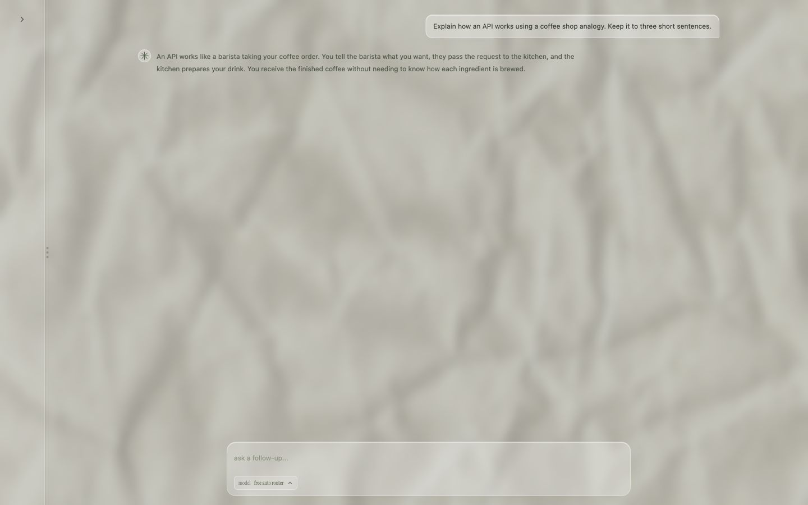
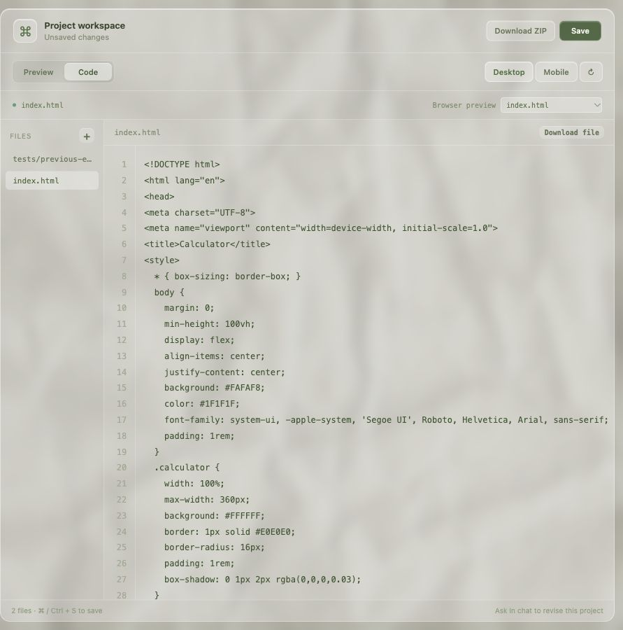
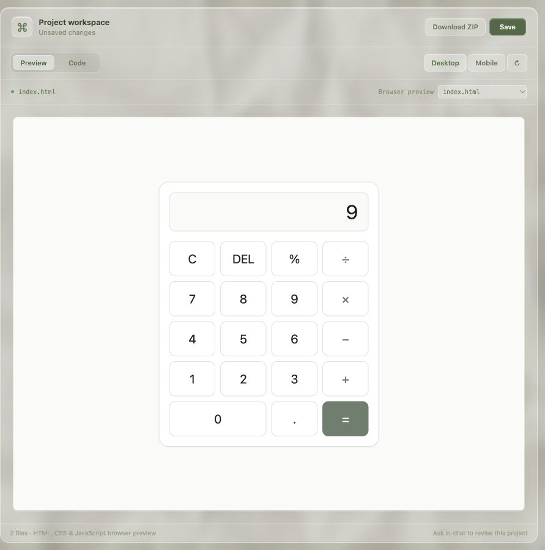
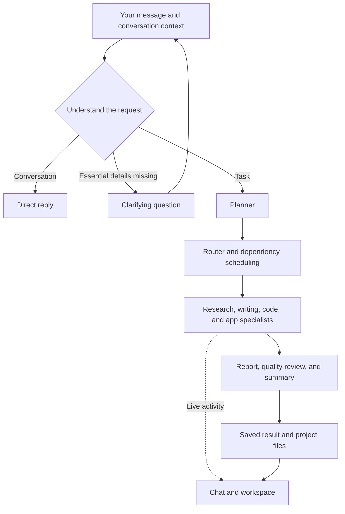

<div align="center">


# Orian

### From a conversation to something real.

A conversational assistant with specialist agents, connected apps, and a coding workspace.<br />
Ask a question, build a website, research an idea, or get work done in your apps.

**[Open Orian ↗](https://oriannn.vercel.app)** · [Features](#what-you-can-do) · [Screenshots](#screenshots) · [Local setup](#run-locally) · [Deployment](#deployment)


</div>


## What you can do

| Capability | Experience |
| --- | --- |
| **Have a conversation** | Ask questions, explore ideas, and continue earlier chats with context. Simple messages receive direct replies. |
| **Work with specialist agents** | Follow task progress, agent assignments, and the current step. Orian asks for essential missing details before proceeding. |
| **Build and refine websites** | Generate files, edit code, preview a site, and request changes beside the conversation. |
| **Keep your project** | Save edits, download individual files, or export the whole workspace as a ZIP with its folder structure. |
| **Use connected apps** | Work in Notion, Google Docs, Slack, GitHub, Linear, and Airtable through your own authorized connections. |
| **Research and write** | Search the web with sources, compare options, and turn findings into a report or document. |
| **Pick up where you left off** | Reopen a conversation with its messages, saved results, and project files. |

The interface uses Orian's textured background, serif typography, and translucent glass panels. Resize the sidebar, chat, and coding workspace to fit the way you work.

## Screenshots

Captured from the signed-in [live app](https://oriannn.vercel.app): a real AI response and the saved calculator project's code and browser preview. The workspace images are cropped to focus on the editor and preview controls.

### A real conversation

Orian explains an API using a coffee shop analogy, with Free Auto selected.



### Code workspace

Browse generated files, edit `index.html`, and download an individual file or the entire project as a ZIP.



### A working live preview

The saved calculator runs inside Orian's sandboxed preview. The screenshot shows the result of clicking **7 + 2 =**, verified in the browser.



## Try a conversation

- **Chat:** “Explain how APIs work with a simple example.”
- **Build:** “Build a personal portfolio website with a dark theme.”
- **Revise:** “Make the navigation sticky and improve the mobile layout.”
- **Connect:** “Create a weekly planner in Notion under my Projects page.”
- **Write:** “Turn these notes into a project proposal in Google Docs.”
- **Research:** “Compare free AI coding models and include sources.”

Connect the relevant app before requesting an app action. If a destination or another essential detail is missing, answer Orian's follow-up question in the same conversation.

## How it works



The Express API authenticates requests with Clerk, stores conversations and results in MongoDB, and queues tasks with BullMQ and Redis. Socket.IO streams activity to the frontend; polling recovers updates if the socket disconnects. Agent assignments and progress are persisted with the task.

### Free AI models

**Free Auto** is the default. It uses [OpenRouter's free router](https://openrouter.ai/openrouter/free) to select an available free model. The model selector also offers a free NVIDIA Nemotron variant.

- Every inference request sets a zero prompt/completion price ceiling.
- Paid model overrides are rejected, with no paid fallback.
- An unavailable selected free model can fall back to Free Auto.
- Free models have availability and rate limits; quota errors do not trigger paid inference.

An [OpenRouter API key](https://openrouter.ai/settings/keys) is required. Free inference does not mean unlimited usage; hosting, search, authentication, and connector services have their own plans and quotas.

### Coding workspace

The workspace includes an editable file browser, desktop/mobile preview modes, save controls, and ZIP export. Follow-up requests include the current project files, including unsaved edits. Revisions update changed files while retaining the rest of the project.

The sandboxed preview supports static HTML, CSS, JavaScript, local styles/scripts, and acyclic local ES module imports. It does not install npm packages or run backend servers or Python. Projects needing those runtimes can still be edited and downloaded. Save manual edits before leaving a conversation.

### Connected apps

Connections are handled through [Composio](https://composio.dev/) and belong to the signed-in user. Orian discovers the available tools and their input schemas, then uses actual tool results to locate destinations and perform requested actions.

1. Sign in and click **connect** beside an app in the sidebar.
2. Authenticate with the provider and grant the permissions you want to use.
3. Use **config** to set a destination where supported, such as a Notion parent page or Slack channel.
4. Describe the action in chat.

App actions use your account permissions. GitHub commits, pushes, and repository file writes are disabled. If an external write succeeds before a workflow fails, inspect the destination before retrying; external actions already in flight cannot be undone by cancellation.

## Tech stack

| Layer | Technology |
| --- | --- |
| Frontend | React 18, Create React App, CSS, Socket.IO client |
| API and orchestration | Node.js, Express, specialist agent modules |
| Authentication | Clerk |
| Persistence | MongoDB with Mongoose |
| Task queue | BullMQ with Redis-compatible storage |
| Live updates | Socket.IO with polling fallback |
| AI inference | OpenRouter, restricted to free models |
| Web research | Tavily |
| App connections | Composio |
| Current hosting | Vercel frontend, Render backend |

## Run locally

### Prerequisites

- Node.js 20 or newer and npm.
- Reachable MongoDB and Redis instances, local or hosted.
- An OpenRouter API key and matching Clerk application keys.
- Optional: Tavily for web research and Composio for app connections.

### 1. Install

```bash
git clone https://github.com/imaryannn/Orian.git
cd Orian
npm run setup
```

### 2. Configure the environment

For a fresh checkout, copy the templates:

```bash
cp server/.env.example server/.env
cp frontend/.env.example frontend/.env
```

Keep your existing `.env` files when updating an installation. Fill in the required credentials; the templates contain no real keys.

| Variable | Location | Purpose |
| --- | --- | --- |
| `MONGODB_URI` | `server/.env` | MongoDB connection string; defaults to local MongoDB for development. |
| `REDIS_URL` | `server/.env` | Redis connection string for the queue. |
| `OPENROUTER_API_KEY` | `server/.env` | Required for AI inference. |
| `CLERK_PUBLISHABLE_KEY` | `server/.env` | Clerk application's public key. |
| `CLERK_SECRET_KEY` | `server/.env` | Clerk application's private server key. |
| `FRONTEND_URL` | `server/.env` | Allowed frontend origin; locally `http://localhost:3001`. |
| `BACKEND_URL` | `server/.env` | Public backend URL for connector callbacks; locally `http://localhost:3000`. |
| `TAVILY_API_KEY` | `server/.env` | Optional; enables web research. |
| `COMPOSIO_API_KEY` | `server/.env` | Optional; enables connected apps. |
| `REACT_APP_BACKEND_URL` | `frontend/.env` | API URL; locally `http://localhost:3000`. |
| `REACT_APP_CLERK_PUBLISHABLE_KEY` | `frontend/.env` | Must match the backend's Clerk application. |

The server template also includes `PORT`, `NODE_ENV`, the free model default, and optional tracing settings. The OAuth callback is `<BACKEND_URL>/integrations/composio/callback`; hosted connections need a publicly reachable backend URL.

**Keep private credentials on the backend.** Every `REACT_APP_*` value is included in the public browser bundle. Only public configuration and Clerk's publishable key belong there. Real `.env` files are ignored by Git; share only the example templates.

### 3. Start

```bash
npm start
```

Open **[localhost:3001](http://localhost:3001)**. The API runs on port **3000**, with a health check at **[localhost:3000/health](http://localhost:3000/health)**. The root command starts both processes; Ctrl+C stops them.

## Development commands

| Command | Purpose |
| --- | --- |
| `npm run setup` | Install frontend and backend dependencies from their lockfiles. |
| `npm start` / `npm run dev` | Run the frontend and backend together. |
| `npm test` | Run backend and frontend regression tests with mocked external services. |
| `npm run build` | Check backend syntax and create the frontend production build. |
| `npm run diagnose` | Make a live free-model request and discover connector tools. |
| `npm --prefix server run smoke` | Check database-backed conversation memory and a local report workflow. |

Live diagnostics consume API quota. The smoke check removes its temporary records/files and does not write to connected apps.

## Project structure

```text
Orian/
├── frontend/
│   ├── public/              # Branding and background assets
│   ├── src/
│   │   ├── components/      # Chat, landing page, editor, integrations
│   │   ├── App.js           # Application shell and conversation state
│   │   ├── workspace.js     # Project normalization and browser preview
│   │   └── workspaceZip.js  # Local ZIP export
│   └── .env.example
├── server/
│   ├── agents/              # Intent, planner, router, specialists, review
│   ├── db/                  # MongoDB models and provider settings
│   ├── lib/                 # Conversation and workspace helpers
│   ├── queues/              # BullMQ queue and worker
│   ├── routes/              # Goals, tasks, settings, connections
│   ├── services/            # State management and Composio integration
│   ├── sockets/             # Authenticated live activity
│   ├── tools/               # Executor, LLM, research, result formatting
│   ├── test/                # Backend regression tests
│   └── .env.example
├── docs/screenshots/        # README images
├── scripts/dev.js          # Local process launcher
└── package.json            # Root development commands
```

`server/db/sqlite.js` is a legacy filename: the active database is MongoDB. The older `server/src` workflow experiment is not mounted by the main server.

## Deployment

**Live app:** [oriannn.vercel.app](https://oriannn.vercel.app)

**API health:** [orian-ondq.onrender.com/health](https://orian-ondq.onrender.com/health)

| Setting | Frontend · Vercel | Backend · Render |
| --- | --- | --- |
| Root directory | `frontend` | `server` |
| Install/build | `npm ci` then `npm run build` | `npm ci && npm run build` |
| Output/start | Output directory: `build` | Start command: `npm start` |
| Public URL configuration | `REACT_APP_BACKEND_URL` | `FRONTEND_URL`, `BACKEND_URL` |
| Authentication | Clerk publishable key | Matching Clerk publishable and secret keys |
| Other credentials | None of the backend secrets | MongoDB, Redis, OpenRouter, optional Tavily/Composio |

Set production variables in the hosting dashboards, not in source control. The backend listens on the host-provided `PORT`. Rebuild the frontend after changing its environment variables, and redeploy the backend after changing its configuration.

For a production authentication setup, use matching keys from a Clerk production instance. Free Render web services can sleep when idle, so the first request may take longer. Free Render Key Value storage has no disk persistence; queued data can be lost on a restart. Conversations and saved project files are stored in MongoDB.

## Troubleshooting

| Symptom | Check |
| --- | --- |
| Sign-in does not load or requests return `401` | Set the frontend Clerk publishable key and ensure both sides use the same Clerk application. Rebuild after frontend environment changes. |
| API does not start | Check MongoDB and Redis connectivity and required OpenRouter/Clerk variables. |
| Frontend cannot reach the API | Check `REACT_APP_BACKEND_URL` and the backend's allowed `FRONTEND_URL`. |
| AI returns a quota or availability error | Check the OpenRouter free-model limits and retry later. Orian does not switch to a paid model. |
| Connected app is unavailable | Configure Composio, reconnect expired/revoked connections, and verify permissions and the callback URL. |
| Preview is blank | Check that the project has a visible HTML entry, inspect the preview error, and use the repair action if available. npm/backend projects need an external runtime. |

<details>
<summary><strong>API reference</strong></summary>

Goal, task, model-setting, webhook-trigger, and integration endpoints require a Clerk session token. Goal access is restricted to its owner. The connector callback validates its connection state.

```text
GET    /health
POST   /api/goal
GET    /api/goal
GET    /api/goal/:goalId
POST   /api/goal/:goalId/cancel
PATCH  /api/goal/:goalId/workspace
GET    /api/tasks
GET    /api/tasks/:goalId/status
GET    /api/tasks/:goalId/logs
POST   /api/webhook/trigger
GET    /api/settings/model
POST   /api/settings/model
POST   /api/settings/model/test
GET    /integrations/list
POST   /integrations/connect
POST   /integrations/:provider/config
DELETE /integrations/:provider
```

</details>
